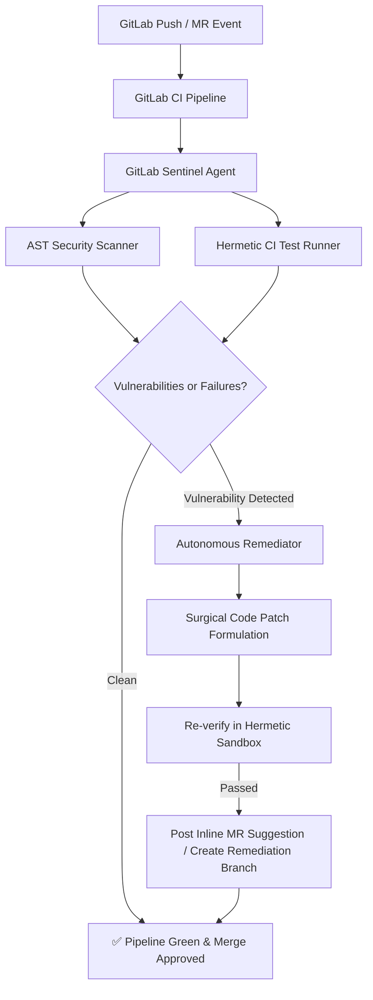

# 🦊 GitLab Sentinel Agent

> **Autonomous DevSecOps & Closed-Loop CI/CD Self-Healing Engine**  
> *Built for GitLab Transcend Hackathon: Life After Code (October 2026)*

[](https://opensource.org/licenses/MIT)
[]()
[]()

---

## 💡 What is GitLab Sentinel?

Code generation is solved. What happens **after the code is written** is where engineering velocity stalls: broken pipelines, security injection vulnerabilities, manual code review friction, and failed test debugging.

**GitLab Sentinel** is an autonomous DevSecOps agent built to automate the post-code lifecycle:
1. **Static AST Security Auditing:** Scans source code before deployment to detect critical vulnerabilities (CWE-78 Command Injection, CWE-89 SQL Injection, CWE-94 Code Injection, and CWE-798 Hardcoded Secrets).
2. **Hermetic Sandboxed Test Execution:** Spawns an isolated test runner simulating GitLab CI runners, capturing execution traces and pinpointing exact failure sites.
3. **Closed-Loop Surgical Remediation:** Automatically synthesizes minimal, verified patches to fix security flaws and test failures without breaking public APIs.
4. **GitLab Merge Request Integration:** Autonomously posts line-level code review discussions with native GitLab inline suggestion blocks (````suggestion ... ````) and opens automated remediation merge requests.

---

## 🏛️ Architecture Flow



---

## 🚀 Quick Start

### 1. Installation
```bash
git clone https://github.com/bhomvratrai-glitch/gitlab-sentinel-agent.git
cd gitlab-sentinel-agent
pip install -r requirements.txt
```

### 2. Run AST Security Scan
```bash
PYTHONPATH=. python3 -m gitlab_sentinel.cli scan examples/vulnerable_app/
```

### 3. Run Hermetic CI Test Runner
```bash
PYTHONPATH=. python3 -m gitlab_sentinel.cli test tests/
```

### 4. Run Autonomous Closed-Loop Self-Healing
```bash
PYTHONPATH=. python3 -m gitlab_sentinel.cli heal examples/vulnerable_app/
```

---

## 🧪 Running Automated Tests

```bash
PYTHONPATH=. python3 -m pytest tests/ -v
# 14 passed in 0.33s
```

---

## 🌐 Live Interactive Web Studio Demo

Explore live simulated pipeline executions and before/after AST diffs at:  
👉 **[https://bhomvratrai-glitch.github.io/gitlab-sentinel-agent/](https://bhomvratrai-glitch.github.io/gitlab-sentinel-agent/)**

---

## 📄 License
MIT License. Open source and free for enterprise DevSecOps automation.
