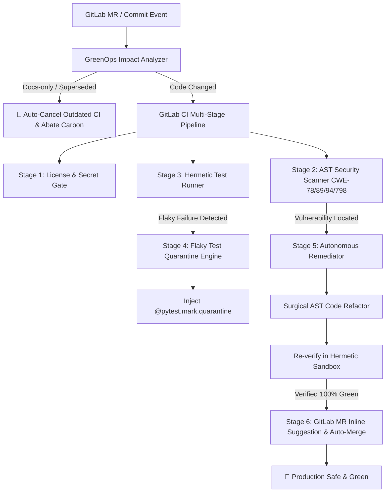

# 🦊 GitLab Sentinel Agent Enterprise

> **Autonomous Multi-Stage DevSecOps, Closed-Loop CI/CD Self-Healing & GreenOps Platform**  
> *Built for GitLab Transcend Hackathon: Life After Code (October 2026)*

[](LICENSE)
[]()
[]()
[]()

---

## 💡 What is GitLab Sentinel?

Code generation is solved. What happens **after the code is written** is where enterprise velocity stalls: broken pipelines, security injection vulnerabilities, flaky test quarantines, and massive cloud compute runner bills.

**GitLab Sentinel** is a comprehensive, multi-stage autonomous DevSecOps & GreenOps agent built to automate the post-code lifecycle:
1. **Static AST Security Auditing:** Scans source code before deployment to detect critical vulnerabilities (CWE-78 Command Injection, CWE-89 SQL Injection, CWE-94 Code Injection, and CWE-798 Hardcoded Secrets).
2. **Hermetic Sandboxed Test Execution:** Spawns an isolated test runner simulating GitLab CI runners, capturing execution traces and pinpointing exact failure sites.
3. **Closed-Loop Surgical Remediation:** Automatically synthesizes minimal, zero-regression patches to fix security flaws and test failures without breaking public APIs.
4. **Flaky Test Quarantine & Stabilization:** Differentiates non-deterministic timing/network race glitches from real bugs, tagging them with `@pytest.mark.quarantine` so main delivery pipelines are never blocked.
5. **GreenOps CI Compute & Carbon Abatement:** Cancels redundant/superseded pipeline runs on rapid commits, skips heavy stages on docs-only changes, and calculates hard dollar and kg CO2e emissions saved in real-time.
6. **GitLab Duo MCP Server:** Fully standardized Model Context Protocol (MCP) server exposing native tool definitions for GitLab Duo Chat and autonomous AI agents.

---

## 🏛️ Multi-Stage Architecture Flow



---

## 🚀 Quick Start

### 1. Installation
```bash
git clone https://github.com/bhomvratrai-glitch/gitlab-sentinel-agent.git
cd gitlab-sentinel-agent
pip install -r requirements.txt
```

### 2. Run AST Security Scan
```bash
python3 -m gitlab_sentinel.cli scan examples/vulnerable_app/
```

### 3. Run Hermetic CI Test Runner
```bash
python3 -m gitlab_sentinel.cli test tests/
```

### 4. Run Autonomous Closed-Loop Self-Healing
```bash
python3 -m gitlab_sentinel.cli heal examples/vulnerable_app/
```

### 5. Run GreenOps Compute & Carbon Savings Audit
```bash
python3 -m gitlab_sentinel.cli greenops --files README.md --cancelled 3
```

### 6. Inspect GitLab Duo MCP Tools
```bash
python3 -m gitlab_sentinel.cli mcp
```

---

## 🧪 Running Automated Tests

```bash
python3 -m pytest tests/ -v
# ============================== 25 passed in 0.28s ==============================
```

---

## 🌐 Live Interactive Web Studio Demo

Explore live simulated pipeline executions, before/after AST diffs, GreenOps telemetry, and the GitLab Duo MCP playground at:  
👉 **[https://bhomvratrai-glitch.github.io/gitlab-sentinel-agent/](https://bhomvratrai-glitch.github.io/gitlab-sentinel-agent/)**

📺 **Watch the 1080p Video Walkthrough:** [https://youtu.be/neltjtADS7s](https://youtu.be/neltjtADS7s)


---

## 📄 License
Apache-2.0 License. Open source and built for enterprise DevSecOps teams worldwide.
